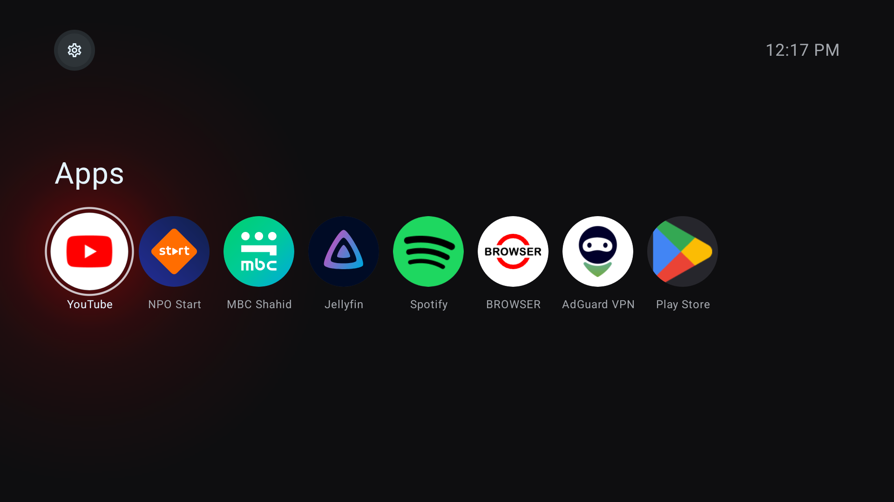

#  

Launchery is an alternative launcher for Android TV and Google TV that mainly does less. It leaves out the advertising,
sponsored recommendations, and promotional clutter that compete for your attention, and sticks to the essentials: a
simple home screen for opening apps.



Launchery doesn't request the `INTERNET` permission, so it can't connect to the internet at all. The only Android
permission it requests is `REQUEST_DELETE_PACKAGES`, which lets it open the system's uninstall dialog.

## Status

Launchery 0.1.0 is a pre-release. It requires Android 14 (API level 34) or higher. It has been tested only on a
Chromecast with Google TV (4K) running Android 14, where it works as the home screen. The Chromecast with Google TV (HD)
and other Android TV and Google TV devices are untested. Test results in this README come from that Chromecast.

## Usage

https://github.com/user-attachments/assets/c3a6c656-bec2-423e-8251-08950a626a5b

- Press Select to open an app. Press and hold Select to show its actions: **App info**, **Move**, **Hide**, and, for
  apps you installed, **Uninstall**. **Force stop** is in **App info**.
- Press Left or Right to move along the row. At the first or last app, press and hold the button to wrap around to the
  other end. A short press there does nothing, so a stray press never wraps around.
- Press Up to reach the settings button, and press Select to open the settings:
  - **Show apps as** switches between round icons and banners.
  - **Hidden apps** lists the apps you've hidden.
  - **All settings** opens the system settings.

  To go straight to the system settings, press and hold Select on the settings button.

## Install

Before you begin, you need:

- A computer with [`adb`](https://developer.android.com/tools/adb), on the same network as the TV. The commands work
  the same in any shell.
- **Wireless debugging** turned on in the TV's Developer options. To show **Developer options**, go to
  **Settings > System > About** and select **Android TV OS build** seven times. Wireless debugging is then in
  **Settings > System > Developer options**.

> [!WARNING]
> Install and open Launchery before you disable the stock launcher. Without another home app, the TV has no home
> screen, and Settings becomes hard to reach.

1. Download `launchery-0.1.0.apk` and `launchery-0.1.0.apk.sha256` from the
   [Releases page](https://github.com/sanderbongers/launchery/releases), and then
   [verify the download](#verify-the-download).
2. Pair with the TV and connect to it:

   ```bash
   adb pair <tv-ip>:<pairing-port>
   adb connect <tv-ip>:<connection-port>
   ```

   Use the IP address, ports, and pairing code shown on the TV's **Wireless debugging** screen. `adb pair` prompts for
   the pairing code.

3. Install Launchery:

   ```bash
   adb install -r launchery-0.1.0.apk
   ```

4. On the TV, open Launchery once from the app list.
5. Optional: Compile Launchery ahead of time:

   ```bash
   adb shell cmd package compile -f -m speed-profile rs.bonge.launchery
   ```

6. Note the package name of the app that holds the Home role now, so that you can give the role back later:

   ```bash
   adb shell cmd role get-role-holders android.app.role.HOME
   ```

7. Make Launchery the home screen: give it the Home role, and disable the stock launcher and `setupwraith`:

   ```bash
   adb shell cmd role add-role-holder --user 0 android.app.role.HOME rs.bonge.launchery
   adb shell pm disable-user --user 0 com.google.android.apps.tv.launcherx
   adb shell pm disable-user --user 0 com.google.android.tungsten.setupwraith
   ```

8. Press Home and check that Launchery opens. If it doesn't, [restore the stock launcher](#restore-the-stock-launcher).

### Verify the download

Check the checksum:

```bash
shasum -a 256 -c launchery-0.1.0.apk.sha256
```

The output ends in `OK`.

Check the signing certificate with `apksigner` from the Android SDK Build-Tools:

```bash
apksigner verify --print-certs launchery-0.1.0.apk
```

The output must include these lines:

```text
Signer #1 certificate DN: CN=Launchery
Signer #1 certificate SHA-256 digest: 20e974b26c7c12639b36f9f8373053e13df03c5c704a8be36a6925a251442c64
```

If either check fails, don't install the APK.

## Update

Launchery doesn't update itself. To install a newer version:

1. Download the new APK and its `.sha256` file, and [verify the download](#verify-the-download).
2. Connect to the TV as in step 2 of [Install](#install).
3. Install the new version over the current one:

   ```bash
   adb install -r launchery-<version>.apk
   ```

4. Optional: After you open the new version once, compile it ahead of time, as in step 5 of [Install](#install).

## Restore the stock launcher

1. Re-enable the stock launcher and `setupwraith`:

   ```bash
   adb shell pm enable com.google.android.apps.tv.launcherx
   adb shell pm enable com.google.android.tungsten.setupwraith
   ```

   Home opens the stock launcher again.

2. Give the Home role back to the app that held it before:

   ```bash
   adb shell cmd role add-role-holder --user 0 android.app.role.HOME <package>
   ```

   Replace `<package>` with the package name you noted in step 6 of [Install](#install).

3. Optional: To remove Launchery as well, uninstall it once Home opens the other launcher:

   ```bash
   adb uninstall rs.bonge.launchery
   ```

## Troubleshooting

### `adb` can't connect

Open the **Wireless debugging** screen: in Launchery, select the settings button and then **All settings**, and go to
**System > Developer options > Wireless debugging**. Then check two things:

- **Wireless debugging is on.** It stayed on after one restart in testing, but others report that it can turn off
  after a restart or sleep.
- **The connection port is current.** It changed after a restart in testing. Connect with the port shown now:

  ```bash
  adb connect <tv-ip>:<connection-port>
  ```

### Launchery doesn't start

[Restore the stock launcher](#restore-the-stock-launcher) with `adb`.

If `adb` can't connect either, Settings is hard to reach without a home screen. Asking the Assistant to open Settings
doesn't work: holding the Assistant button and saying "open settings" showed a "Verify network change" screen instead.
A factory reset is the last resort. It erases all data on the Chromecast, and the data can't be recovered. Google's
[factory reset instructions](https://support.google.com/chromecast/answer/6254654) for the Chromecast with Google TV:
while it's on, press and hold the button on its back until the LED blinks yellow, and then release it when the LED
turns solid white. These steps come from Google and weren't tested.

## Known issues

With the stock launcher disabled:

- **The YouTube button does nothing.** Launchery receives no key event from it, and the system doesn't open anything.
  An app that remaps buttons can give it a target: in testing, TV Quick Actions made it open SmartTube.
- **An app that remaps Home takes Home away from Launchery.** With Home mapped to Projectivy in TV Quick Actions, Home
  opened Projectivy and never reached Launchery. Once that mapping was removed, Home opened Launchery again.
- **The stock launcher's profile switcher and quick settings panel are gone.** This follows from disabling the stock
  launcher and wasn't checked in testing.

These kept working with the stock launcher disabled:

- Home and Back.
- Restarting the TV.
- Sleep and wake. Launchery kept running, and was back about a tenth of a second after the screen turned on.
- The volume buttons, when the remote's volume control is set to the Chromecast.
- Casting from a phone, tried with NLZIET and NPO Start (video) and Spotify (audio, which plays in the background
  without a screen on the TV). Some people report that disabling the stock launcher breaks casting. In testing, video
  casting failed for a few minutes soon after a restart, while an earlier Spotify cast was still running. The cause
  wasn't found, and the same apps cast fine later.

## Development

Building Launchery requires JDK 17 or higher and the Android SDK with the SDK Platform for API level 37.2. Set
`JAVA_HOME` to the JDK and `ANDROID_HOME` to the SDK, or set `sdk.dir` in `local.properties`.

```bash
./gradlew check          # Run lint, the format check, and unit tests
./gradlew assembleDebug  # Build a debug APK in app/build/outputs/apk/debug/
./gradlew spotlessApply  # Fix formatting
```

### Build a signed release

In your terminal, set the environment variables `LAUNCHERY_KEYSTORE_FILE` (an absolute path), `LAUNCHERY_KEY_ALIAS`,
and `LAUNCHERY_KEYSTORE_PASSWORD`, and then build the release and stop the Gradle daemon:

```bash
./gradlew assembleRelease --no-configuration-cache
./gradlew --stop
```

The signed APK is `app/build/outputs/apk/release/app-release.apk`.

## License

Launchery is released under the [MIT License](LICENSE).

Android TV, Google TV, and Chromecast are trademarks of Google LLC.
