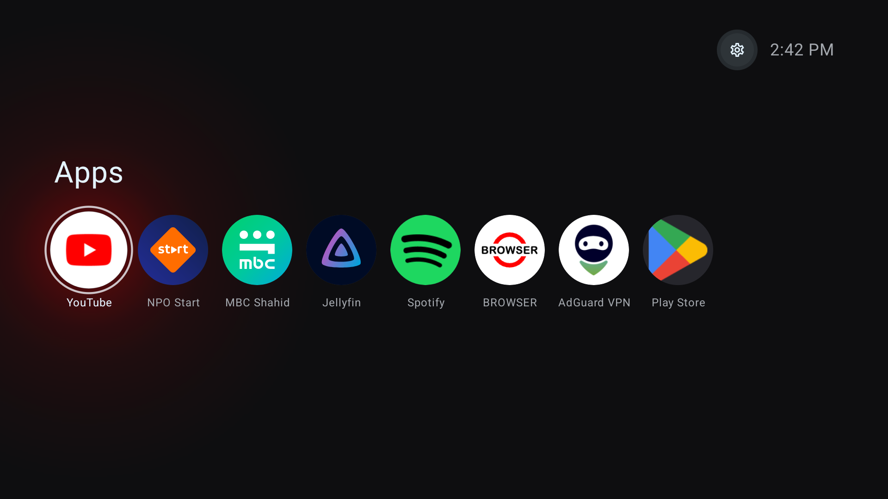

#  

Launchery is a launcher for Android TV and Google TV that mainly does less. No ads, no recommendations, no rows of
content you didn't ask for: just your apps.

It doesn't have the `INTERNET` permission, so it can't go online at all. Its only permission is
`REQUEST_DELETE_PACKAGES`, to open the system's uninstall dialog.



## Features

- One row of apps, as round icons or banners.
- Move, hide and uninstall apps from the home screen.
- A settings panel for some Launchery options (round app icons vs banners, unhiding apps) and the system settings.
- No account, no network access, no background services.

## Requirements

- Android 14 or newer. Launchery 0.2.0 is a pre-release, tested only on a Chromecast with Google TV (4K) running
  Android 14.
- A computer with [`adb`](https://developer.android.com/tools/adb) on the same network as the TV.
- **Wireless debugging** turned on. To show **Developer options**, select **Android TV OS build** seven times in
  **Settings > System > About**.

## Install

1. Download `launchery-0.2.0.apk` and its `.sha256` file from
   [Releases](https://github.com/sanderbongers/launchery/releases), and [verify them](#verify-the-download).
2. Pair with the TV and connect, using the address, ports and code on the TV's
   **Settings > System > Developer options > Wireless debugging** screen:

   ```bash
   adb pair <tv-ip>:<pairing-port>
   adb connect <tv-ip>:<connection-port>
   ```

3. Install Launchery, then open it once from the TV's app list to check that it starts:

   ```bash
   adb install -r launchery-0.2.0.apk
   ```

4. Note which app is the home screen now, so you can switch back later. On a TV without another launcher, this is the
   stock launcher, `com.google.android.apps.tv.launcherx`.

   ```bash
   adb shell cmd role get-role-holders android.app.role.HOME
   ```

5. Make Launchery the home screen, and disable the stock launcher and `setupwraith`
   ([why](#why-does-launchery-disable-two-google-apps)):

   ```bash
   adb shell cmd role add-role-holder --user 0 android.app.role.HOME rs.bonge.launchery
   adb shell pm disable-user --user 0 com.google.android.apps.tv.launcherx
   adb shell pm disable-user --user 0 com.google.android.tungsten.setupwraith
   ```

6. Press Home. If another launcher opens, remove its Home mapping from your button remapping app. If nothing opens,
   [switch back](#switch-back-to-the-stock-launcher).

For a faster first start, you can compile it ahead of time:

```bash
adb shell cmd package compile -f -m speed-profile rs.bonge.launchery
```

### Verify the download

```bash
shasum -a 256 -c launchery-0.2.0.apk.sha256
apksigner verify --print-certs launchery-0.2.0.apk
```

The first should end in `OK`. The second (from the Android SDK Build-Tools) must show:

```text
Signer #1 certificate DN: CN=Launchery
Signer #1 certificate SHA-256 digest: 20e974b26c7c12639b36f9f8373053e13df03c5c704a8be36a6925a251442c64
```

If either check fails, don't install it.

## Usage

- Press and hold Select on an app for **App info**, **Move**, **Hide** and, for apps you installed, **Uninstall**.
- At either end of the row, press and hold Left or Right to wrap around.
- The settings button sits above the row. Press and hold Select on it to go straight to the system settings.

## Update

Launchery doesn't update itself. Download and verify the new version, connect as in step 2, and install it over the
old one:

```bash
adb install -r launchery-<version>.apk
```

## Switch back to the stock launcher

```bash
adb shell pm enable com.google.android.apps.tv.launcherx
adb shell pm enable com.google.android.tungsten.setupwraith
adb shell cmd role add-role-holder --user 0 android.app.role.HOME <package>
```

Use the package you noted in step 4 of [Install](#install). To remove Launchery as well:
`adb uninstall rs.bonge.launchery`.

## Troubleshooting

**`adb` can't connect.** Wireless debugging can turn itself off after a restart, and its port changes. Check it in
Launchery's settings panel, **All settings > System > Developer options > Wireless debugging**, and connect with the
port shown there.

For a port that stays the same, turn on **Settings > ADB > Restore ADB port on boot** in tvQuickActions. It needs a
one-time permission:

```bash
adb shell pm grant dev.vodik7.tvquickactions android.permission.WRITE_SECURE_SETTINGS
```

After each restart, you can then connect with `adb connect <tv-ip>:5555`.

## Known issues

These come from disabling the stock launcher and `setupwraith`.

### Casting video stops working after a restart

The Cast receiver gets its device key from `setupwraith`, which [step 5](#install) disables. To fix it until the
receiver restarts, which it also does by itself every night, run:

```bash
adb shell pm enable com.google.android.tungsten.setupwraith
sleep 75
adb shell pm disable-user --user 0 com.google.android.tungsten.setupwraith
```

To fix it for good, see [How do I keep casting working?](#how-do-i-keep-casting-working)

### The YouTube button does nothing

A button remapper such as tvQuickActions can give it a target.

## FAQ

### Why does Launchery disable two Google apps?

Google TV sends the Home button to its stock launcher, even when another launcher is set as the home app. Launchers that
leave it enabled work around this with an accessibility service, often from a remapping app such as tvQuickActions,
that catches Home and opens the launcher instead. That works without `adb`, but the stock launcher keeps running in the
background, and every button press passes through the service first.

Launchery takes the direct route: with the stock launcher disabled, Android sends Home to the home app. `setupwraith`
(Google's setup app) has to go as well, because Home would then open its recovery screen, which keeps restarting the
TV's system after a reboot. The cost is [casting](#casting-video-stops-working-after-a-restart), which can actually be
kept working!

### How do I keep casting working?

The Cast receiver only needs `setupwraith` for a moment: once it has loaded its device key, it keeps it until it
restarts. Enabling `setupwraith` once after each boot isn't enough, because the receiver also restarts itself
every night.

[tvQuickActions Pro](https://play.google.com/store/apps/details?id=dev.vodik7.tvquickactions) can enable `setupwraith`
on the TV itself whenever the receiver asks for it (the free version is untested):

1. In its settings, turn on **Use ADB for some actions**.
2. Go to **Custom actions > ADB commands** and add two commands:
   - Title `Enable setupwraith`, icon `cog`, action `pm enable com.google.android.tungsten.setupwraith`.
   - Title `Disable setupwraith`, icon `cog_off`, action
     `pm disable-user --user 0 com.google.android.tungsten.setupwraith`.
3. Go to **Trigger actions & macros**, select **Add**, and set the title to `Restore casting` and the icon to
   `cmd_cast_connected`. Add three actions: `Enable setupwraith` from **Custom actions**, a 75-second **Delay**, and
   `Disable setupwraith`.
4. Under **Triggers**, select **Add > Logcat Entry**. Set **Tag** to `ActivityThread`, **Filter** to
   `CastInfoProvider` (the filter type is already **Contains**) and **Timeout** to 60.

When the receiver can't find its key, Android logs a line with that tag and filter. The macro then enables
`setupwraith`, the receiver picks up the key at its next attempt (at most a minute later, hence the 75 seconds), and the
macro disables `setupwraith` again.

## Development

You need JDK 17 or newer and the Android SDK with platform 37.2. Set `JAVA_HOME` and `ANDROID_HOME`, or `sdk.dir` in
`local.properties`.

```bash
./gradlew check          # lint, format check and unit tests
./gradlew assembleDebug  # debug APK in app/build/outputs/apk/debug/
./gradlew spotlessApply  # fix formatting
```

For a signed release, set `LAUNCHERY_KEYSTORE_FILE` (absolute path), `LAUNCHERY_KEY_ALIAS` and
`LAUNCHERY_KEYSTORE_PASSWORD`, then:

```bash
./gradlew assembleRelease --no-configuration-cache
./gradlew --stop
```

The APK ends up in `app/build/outputs/apk/release/app-release.apk`.

## License

[MIT](LICENSE). Android TV, Google TV and Chromecast are trademarks of Google LLC.
